# ПР-49,50. Покрокова розробка Web додатку

**Тема:** Розробка веб-клієнта для системи обліку поштових відправлень PostService з використанням HTML, CSS, JavaScript та Fetch API  
**Мета:** Навчитися проєктувати та створювати клієнтську частину веб-застосунку для взаємодії з REST API поштового сервісу; опанувати побудову SPA-структури (Single Page Application) на базі HTML5, CSS3 та чистого JavaScript; реалізувати асинхронні HTTP-запити (GET, POST, PUT, DELETE) за допомогою Fetch API; розробити дизайн інтерфейсу на основі макетів, стилізувати інтерфейс та налаштувати механізм автономної роботи (Offline mode / LocalStorage).

---

## 1. Макети та дизайн інтерфейсу (UI / UX Mockups)

Дизайн веб-застосунку розроблено за принципами Single Page Application (SPA) із застосуванням концепції карток (card-based design). Усі сторінки перемикаються динамічно без перезавантаження сторінки у браузері.

### Макет 1. Головна сторінка застосунку
Містить привітальний заголовок, опис системи, інтерактивні картки швидкого переходу між розділами та блок налаштування адреси API-сервера зі статусним бейджем підключення.
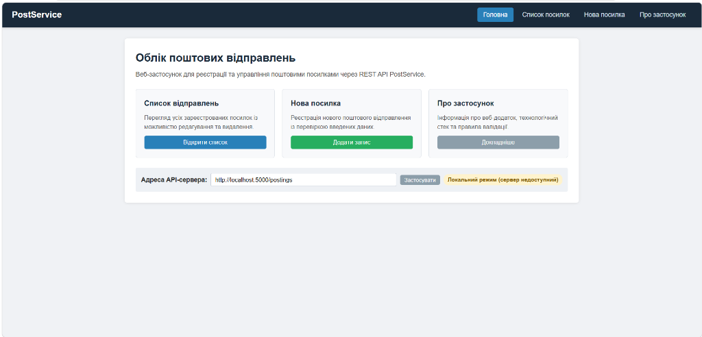

### Макет 2. Список поштових відправлень (Таблиця)
Відображає перелік зареєстрованих посилок із детальною інформацією: номер, опис, відправник, одержувач, тип доставки, вага, габарити, оцінка, вартість, а також кнопки дій для кожного рядка («Редагувати» та «Видалити»).
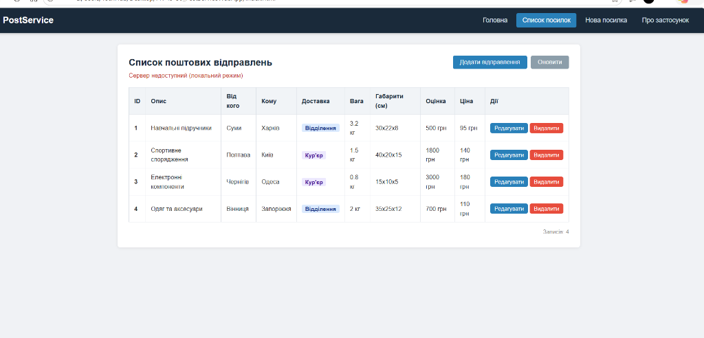

### Макет 3. Форма додавання та редагування посилки
Форма введення обов'язкових даних поштового відправлення з полями для відправника, одержувача, вмісту, вибору способу доставки, габаритів та вартості з вбудованою клієнтською валідацією.
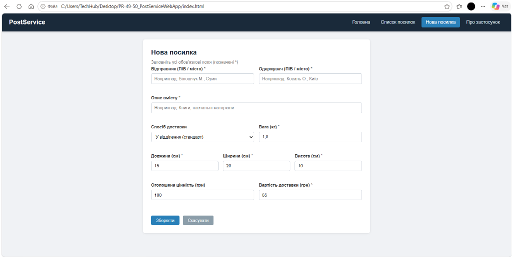

### Макет 4. Інформаційна сторінка «Про застосунок»
Довідковий розділ з описом назви, версії, використаного технологічного стеку (HTML5, CSS3, JavaScript ES6+, Fetch API, LocalStorage) та переліком правил перевірки вхідних даних.
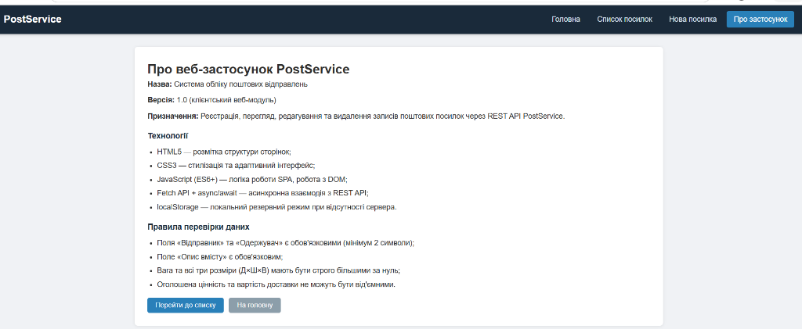

---

## 2. Хід виконання роботи: реалізація стилізації (`style.css`)

Нижче наведено покрокові скріншоти розробки каскадних таблиць стилів у середовищі Visual Studio Code, які забезпечують оформлення макетів та адаптивність інтерфейсу:

#### Скріншот 1. Базові стилі, скидання відступів (reset), параметри шрифтів body та верхня панель навігації (`.navbar`)
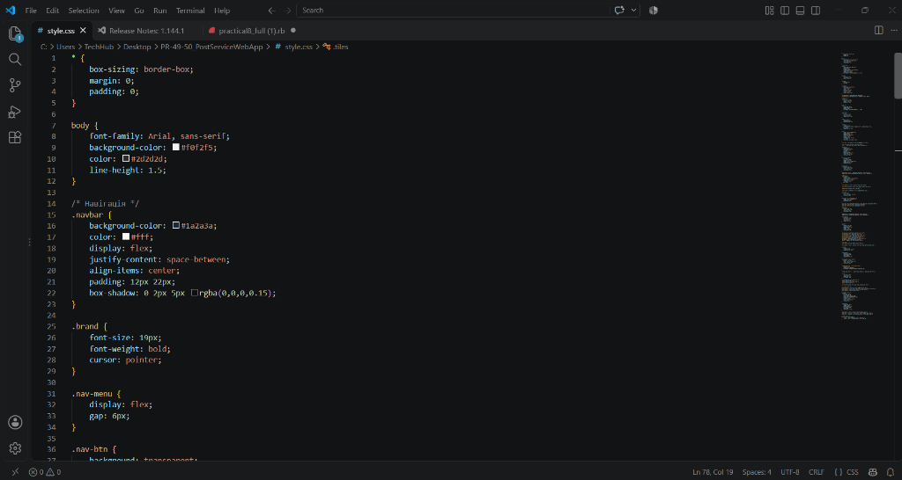

#### Скріншот 2. Стилізація логотипа бренду, кнопок меню навігації (`.nav-btn`), ховер-ефектів та головного контейнера (`.wrapper`)
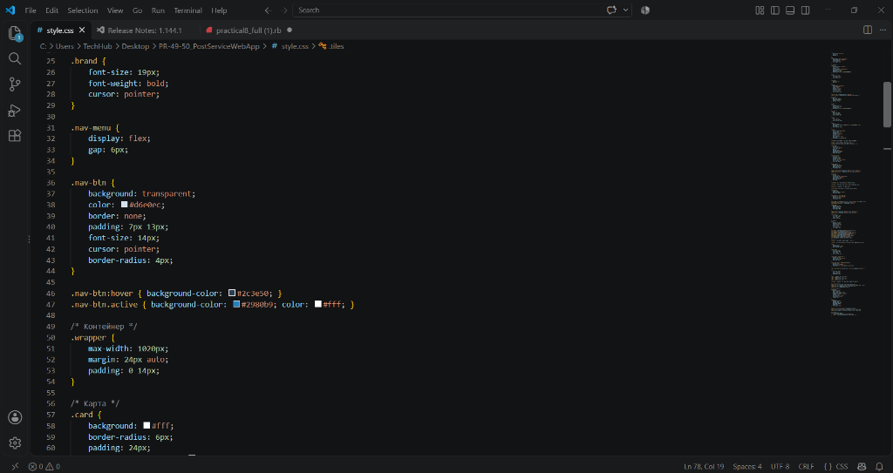

#### Скріншот 3. Активний стан кнопок меню, оформлення картки (`.card`), заголовки та адаптивна CSS Grid сітка карток (`.tiles`)
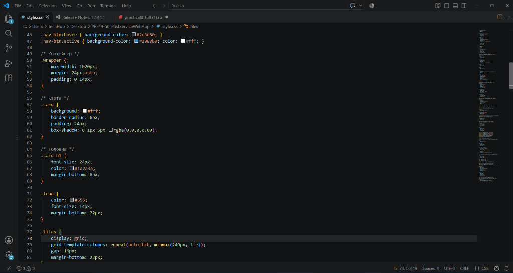

#### Скріншот 4. Оформлення окремої картки-плитки (`.tile`), тіні при наведенні курсору та панель конфігурації API-сервера (`.server-box`)
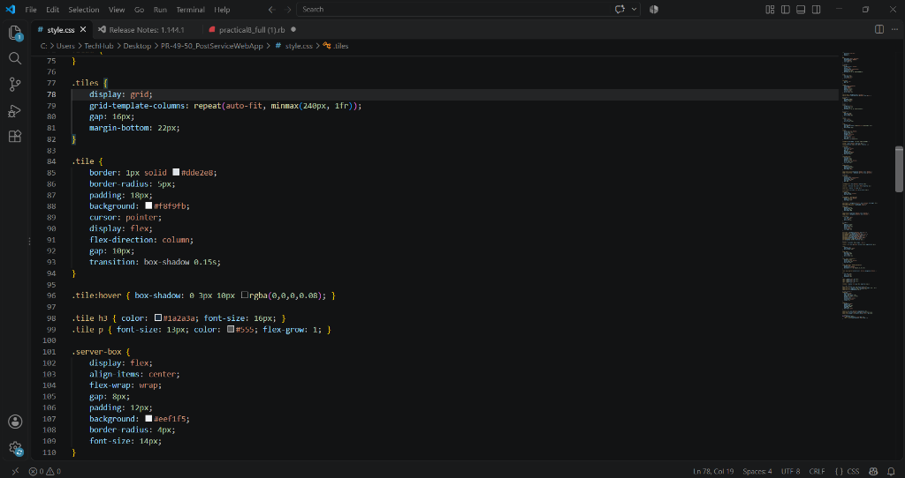

#### Скріншот 5. Стилі полів введення адреси сервера та кольорові бейджі стану підключення (`.badge-status.online`, `.badge-status.offline`)
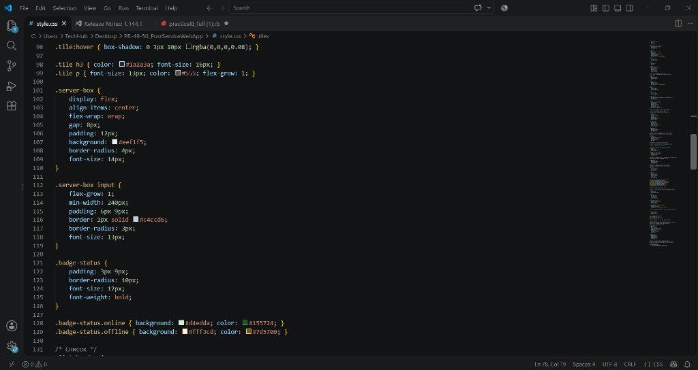

#### Скріншот 6. Оформлення шапки списку відправлень (`.list-header`), таблиці посилок (`.main-table`) та заголовків колонок `th`
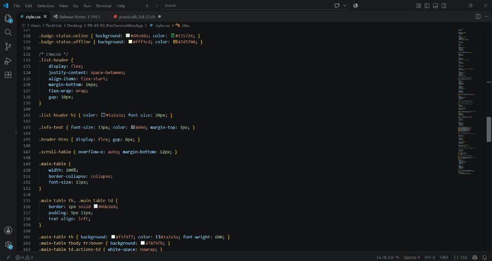

#### Скріншот 7. Стилізація комірок таблиці, підсвічування рядків при наведенні, бейджі способів доставки (`.badge-courier`, `.badge-branch`) і кнопки дій (`.btn`)
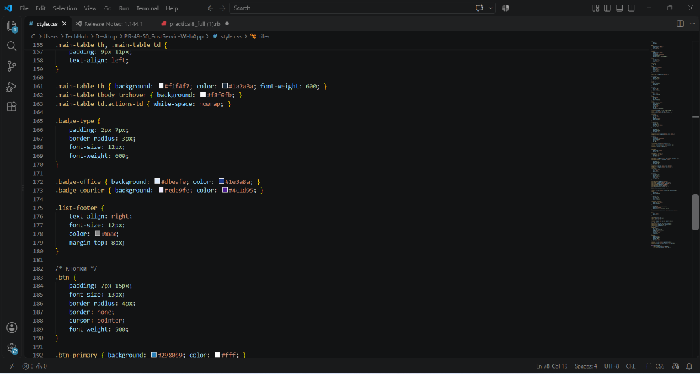

#### Скріншот 8. Кольорові стилі кнопок (`.btn-primary`, `.btn-danger`), контейнер форми введення (`.form-card`) та структурний блок поля (`.field`)
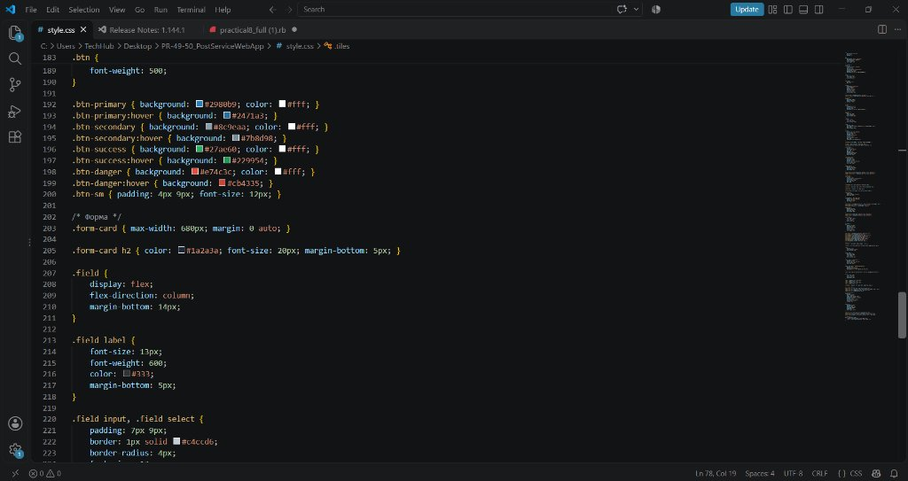

#### Скріншот 9. Оформлення підписів полів (`label`), полів введення, стану фокусу (`focus`), повідомлень про помилки валідації (`.err`) та сіток `.row-2`, `.row-3`
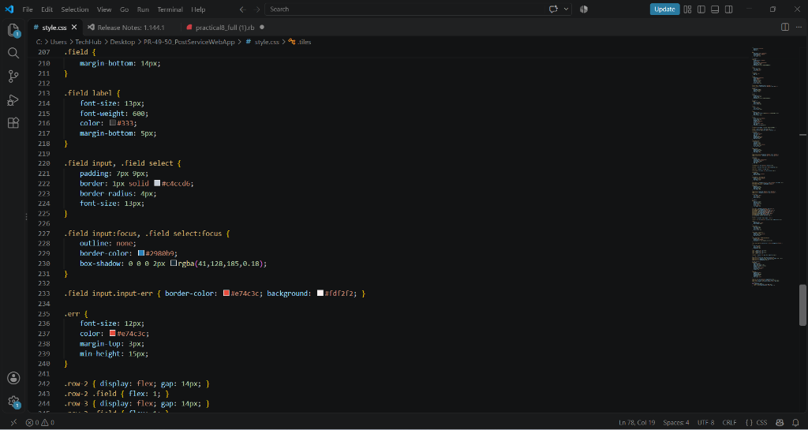

#### Скріншот 10. Помилки валідації, інформаційний блок сторінки «Про застосунок» та напівпрозорий фон модального вікна (`.modal-bg`)
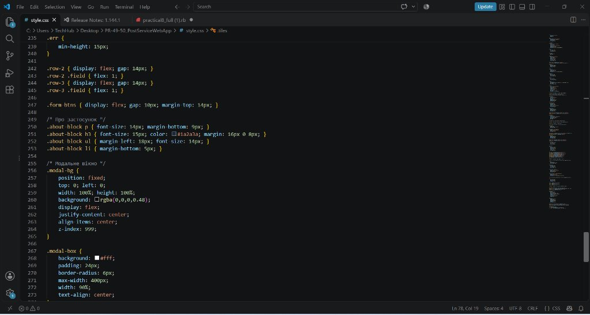

#### Скріншот 11. Оформлення модального вікна підтвердження видалення (`.modal-box`) та медіа-запити адаптивності для мобільних екранів (`@media (max-width: 640px)`)
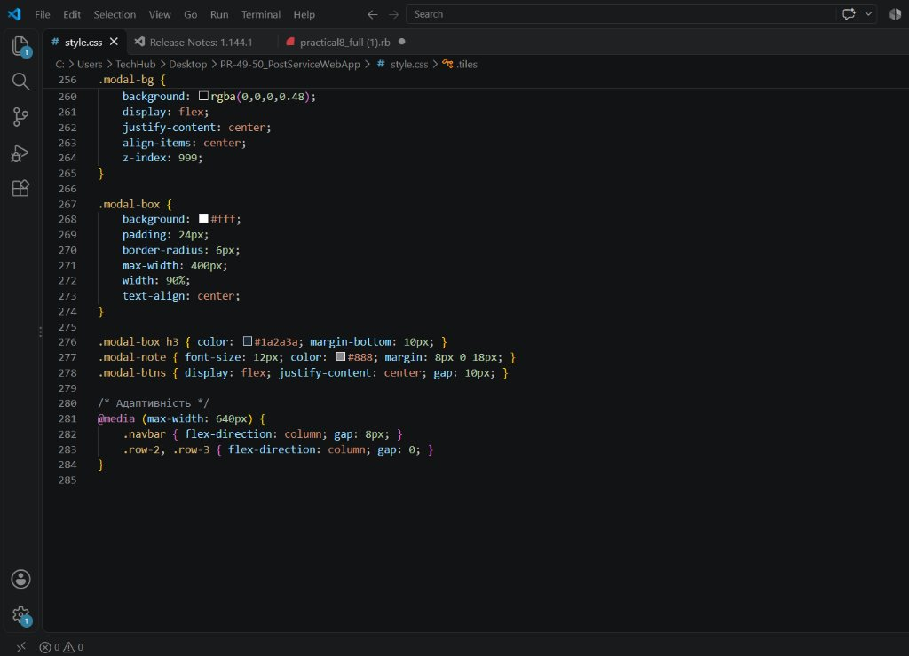

---

## 3. Контрольні запитання

### 1. Що таке Single Page Application (SPA) і які його головні переваги?
Single Page Application (односторінковий застосунок) — це архітектурний підхід, за якого вся веб-сторінка завантажується браузером один раз (файл `index.html`), а всі подальші переходи між розділами відбуваються динамічно засобами JavaScript без перезавантаження сторінки.  
**Переваги:**
- Висока швидкість відгуку інтерфейсу та відсутність «миготіння» екрана при зміні сторінок.
- Економія мережевого трафіку: клієнт обмінюється з сервером лише компактними JSON-даними, а не всім HTML-кодом.
- Зручний користувацький інтерфейс, максимально наближений до звичайних десктопних програм.

### 2. Як працює Fetch API в JavaScript і чим воно відрізняється від XMLHttpRequest?
`Fetch API` — це сучасний вбудований у браузер інструмент для відправки асинхронних HTTP-запитів до веб-сервера.  
**Відмінності від `XMLHttpRequest`:**
- Працює на основі промісів (Promises) та чудово поєднується із синтаксисом `async/await`, що робить код коротким і зручним для читання (без вкладених функцій зворотного виклику — "callback hell").
- Має зручний інтерфейс конфігурації параметрів запиту (метод, заголовки, тіло) через один об'єкт налаштувань.
- Підтримує сучасний механізм переривання запитів за таймаутом через `AbortController`.

### 3. Які HTTP-методи використовуються для реалізації CRUD-операцій у REST API?
- **Create (Створення):** метод `POST` — відправляє на сервер дані нового відправлення у форматі JSON у тілі запиту.
- **Read (Отримання):** метод `GET` — зчитує перелік усіх зареєстрованих посилок без модифікації даних.
- **Update (Редагування):** метод `PUT` — оновлює існуючий запис за його адресою з ID (`/postings/{id}`).
- **Delete (Видалення):** метод `DELETE` — вилучає запис із бази даних за відповідним ідентифікатором.

### 4. У чому різниця між Flexbox та CSS Grid, і як вони використані у проєкті?
- **Flexbox** призначений для одновимірного вирівнювання елементів (або в один рядок, або в один стовпчик). У нашому застосунку він використаний для навігаційного меню (`.navbar`), шапки списку (`.list-header`) та вирівнювання кнопок дій.
- **CSS Grid** призначений для побудови двовимірних гнучких сіток (одночасно по вертикалі та горизонталі). У проєкті Grid використаний для сітки головних карток (`.tiles` із властивістю `repeat(auto-fit, minmax(240px, 1fr))`) та для розміщення полів форми в декілька однакових колонок (`.row-2`, `.row-3`).

### 5. Для чого потрібна клієнтська валідація даних у формах?
Клієнтська валідація перевіряє заповненість полів та правильність форматів безпосередньо у браузері користувача ще до моменту відправки запиту на сервер. Вона миттєво підсвічує пропущені поля або некоректні значення (наприклад, від'ємну вагу чи нульові габарити), не перевантажуючи мережу та сервер порожніми запитами, що суттєво покращує зручність користування.

### 6. Яка роль LocalStorage та демо-режиму в цьому застосунку?
`localStorage` дозволяє зберігати масив посилок локально в пам'яті браузера. Якщо бекенд-сервер API тимчасово не запущений або відсутній інтернет, застосунок не ламається, а автоматично підвантажує список із локального сховища або готових демо-даних, дозволяючи користувачеві повноцінно протестувати додавання, редагування та видалення.

---

## 4. Висновок
Під час виконання практичної роботи № 49–50 було успішно розроблено веб-клієнт для системи обліку поштових відправлень *PostService*. На основі спроєктованих макетів інтерфейсу (головна сторінка, список відправлень, форма додавання/редагування та інформаційна панель) реалізовано адаптивний Single Page Application на базі HTML5, CSS3 та JavaScript. Було практично закріплено технологію Fetch API для виконання операцій CRUD над REST-сервісом, налаштовано перевірку коректності введених даних користувача та реалізовано надійне збереження стану в LocalStorage для роботи в автономному режимі.
